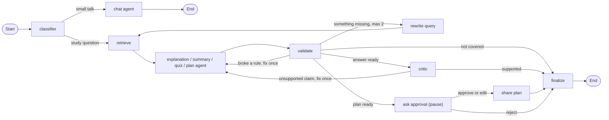

# AI Study Assistant — a LangGraph agent for studying from your own course material

COSC726 project · Domain: **education** · Framework: **LangGraph** (Level 3 — Advanced Agentic System)

---

## 1. What it does

Students often ask a general-purpose chatbot about their course and get answers that sound right but come from
somewhere else, cannot be checked, or do not match their lecture. This assistant answers **only from the student's
own course material** (a lecture PDF or textbook): it explains, summarizes, writes quizzes and makes study plans,
and **every answer cites the page it comes from**. It is a stateful LangGraph agent: a router decides what the
student wants, the agent searches the PDF, **searches again with a better query** when part of the answer is
missing, **checks its own answer** (citation rules, then a separate critic that compares each claim with the cited
page), **says honestly when something is not in the material**, remembers conversations across restarts, and
**pauses for the student's approval** before the one action that affects other people (sharing a study plan).

### How it works



Every box is one node in `src/agent/graph.py`, and every node lives in its own file in `src/agent/`.

---

## 2. Prerequisites

| What | Details |
|---|---|
| Python | **3.13** (see `.python-version`) |
| uv | The package manager — install it from https://docs.astral.sh/uv/getting-started/installation/ |
| Model | Hosted: **OpenAI `gpt-6-luna`**. An OpenAI API key is needed to run the app and the evaluation — **not** for the tests. |
| LangSmith (optional) | Traces of every run; a free API key from https://smith.langchain.com |
| First run only | Chroma downloads its local embedding model (**about 80 MB, about 1 minute**) the first time it searches. Adding a 600-page textbook takes **a few minutes** (it is cut into about 1,800 pieces). |

---

## 3. Install

Copy the repository URL from GitHub (the green **Code** button), then:

```bash
git clone <repository-url>
cd cosc726-doaa-ahmed
uv sync
```

`uv sync` creates `.venv/` and installs the exact versions pinned in `uv.lock` (including `pytest` for the tests).

---

## 4. Configure

```bash
cp .env.example .env
```

Open `.env` and set your **`OPENAI_API_KEY`**. Everything else is optional:

| Variable | Purpose | Example |
|---|---|---|
| `OPENAI_API_KEY` | the model (app and evaluation) | `sk-...` |
| **`MODEL_PROVIDER`** | **switch the model provider** — empty = OpenAI | `openai`, `ollama` |
| **`MODEL_NAME`** | **switch the model** — empty = `gpt-6-luna` | `gpt-6-luna`, `llama3.1` |
| `LANGSMITH_TRACING` | turn tracing on or off | `true` / `false` |
| `LANGSMITH_API_KEY` | LangSmith tracing | your key |
| `LANGSMITH_PROJECT` | LangSmith project name | `study-assistant` |

**The two variables that switch the model provider are `MODEL_PROVIDER` and `MODEL_NAME`.** For a local model with
[Ollama](https://ollama.com): install Ollama, run `ollama pull llama3.1`, run `uv add langchain-ollama`, and set
`MODEL_PROVIDER=ollama` and `MODEL_NAME=llama3.1`. The system was developed and evaluated with OpenAI `gpt-6-luna`;
other providers work through LangChain but were not evaluated.

`.env` is listed in `.gitignore` and is never committed.

---

## 5. Run

```bash
uv run streamlit run app.py
```

Your browser opens **http://localhost:8501**. When it works you see the title **"AI Study Assistant"**; a sidebar
with **Course material** (an upload box and an **Add PDFs** button), **➕ New chat** and **Your chats**; and a chat
box at the bottom.

**First, add the course material:** upload a course PDF in the sidebar and click **Add PDFs**. You should see
`Added <file name> (<number> chunks)`. This is done once — the material stays in `chroma_db/`. Uploading the
same file again (even under another name) does not create a second copy.

**Course material used in development:** A. Levitin, *Introduction to the Design and Analysis of Algorithms*,
3rd edition. It is copyrighted, so it is **not included** in this repository — use your own copy. The
evaluation's expected page numbers refer to this edition.

A terminal version (no browser) is also available: `uv run python main.py`

---

## 6. Test

```bash
uv run pytest
```

Expected result: **`28 passed`** in under a second.

**The tests need no API key and no network.** They replace the LLM with a fake one that gives prepared answers,
replace the book search with a fake search, keep conversations in memory, and send the mock "share" action to a
temporary file. They check the agent's logic: the citation and quiz checks, every routing decision, the retry
loop and its limit, the critic loop and its limit, and the approval gate (approve, edit, reject, a typo, and the
guardrail).

---

## 7. A worked example

With the textbook added, ask in the app:

**Input:** `what is an algorithm`

**Output** (the wording varies a little between runs):

> An algorithm is a sequence of unambiguous instructions for solving a problem: it produces the required output
> for any legitimate input in a finite amount of time. (Design Analysis of Algorithm.pdf, page 31)
>
> *Route: Explain · searches: 1 · failed checks: 0 · critic rejections: 0 · query: definition of an algorithm*

A correct run **cites page 31**, and **Sources** lists the searched pages, each marked "✅ used in the answer"
or "read, not used".

A question the material does not cover must be declined honestly:

**Input:** `expain photosythiss` → **Output:** `This is not covered in your course material.`
(*searches: 3* — it tried two better queries before giving up.)

A broken run looks different: an answer with no page citation, or a full biology lesson for the second question.

---

## 8. Reproduce the evaluation

```bash
uv run python -m evals.run_eval            # all 16 tasks, agent + 2 baselines (about 100-150 LLM calls)
uv run python -m evals.run_eval --quick    # 3 tasks, agent only (a cheap check)
```

The evaluation runs the 16 tasks in `evals/tasks.json` — 8 questions the book covers (each with its correct pages
and keywords), 3 it does not cover, 3 chat messages, 1 quiz and 1 study plan — on three systems:

| System | What it is |
|---|---|
| **plain LLM** | the model alone: no book, no search |
| **search once** | one search and one answer with the same rules; no retries, checks, critic or memory |
| **full agent** | this LangGraph agent |

It prints, for each system: in-scope questions answered, answers with valid citations, answers citing a correct
page, keyword recall (completeness), out-of-scope questions honestly declined, and the average seconds, LLM calls
and tokens per question. For the agent it also prints routing accuracy, the quiz format, the approval pause,
retries, critic rejections, a task-by-task table, and a list of **problems to look at**.

Every run is saved in `evals/results/`: `run-<date>.json` (every detail) and `latest.md` (the tables). **The numbers
quoted in the report come from the result files saved there.** The model does not allow `temperature=0`, so answers
— and the numbers — vary slightly from run to run; the report gives the range over several runs.

---

## 9. The approval gate

**What it protects:** sharing a study plan with other people — the only **consequential** action. It is a
**mock** action: it writes the plan to `outbox/shared_plans.jsonl`, and nothing is really sent.

**Tool inventory and permission tiers** (`src/agent/actions.py`):

| Tool | Node | Tier | Needs approval |
|---|---|---|---|
| `search_course_material` | `retrieve` | read-only | no — runs automatically |
| `share_study_plan` | `share plan` | consequential | **yes** |

**How to trigger it:** in the app, ask `make me a 3 day study plan for designing algorithms`.

**What the human reviewer sees:** the graph **pauses** (`interrupt()` in `src/agent/approval.py`) and the app shows
a yellow **"⏸️ Approval needed: Share this study plan with your study group?"** message, the plan in an
**editable** box, and three buttons: **✅ Approve**, **✏️ Share my edited version** and **❌ Reject**. The chat input
is locked until a decision is made. The pause is saved in `checkpoints.db`, so it survives a page refresh and an
app restart. In the terminal version, the question is `approve / edit / reject?`.

**Two independent locks (defense in depth):**
1. **The graph:** the only arrow into `share plan` comes from `ask approval`, and only for approve or edit
   (`route_after_approval` in `src/agent/routing.py`). Anything else — including a typo — counts as reject.
2. **The action itself** refuses to run without an approval (`PermissionError`), even if a routing bug sent it
   there. This was tested by planting exactly that bug: the routing test failed, and the plan was still not shared.

---

## 10. Repository map

| Path | What lives there |
|---|---|
| `app.py` | The Streamlit app: chat, PDF upload, saved chats, approval buttons |
| `main.py` | A terminal version of the chat, for quick testing |
| `src/agent/` | The agent — one file per feature; **start with `graph.py`**, the map of every node and arrow |
| `src/rag/` | Reading PDFs, cutting them into pieces, storing and searching them (ChromaDB) |
| `src/models/` | The default model name |
| `tests/` | Offline tests (fake LLM, fake search) — no API key, no network |
| `evals/` | The task set (`tasks.json`), the evaluation harness (`run_eval.py`) and saved results |
| `data/` | Local course PDFs — not committed (copyright) |
| `docs/` | Project documentation |
| `reports/` | The report |
| `chroma_db/`, `checkpoints.db`, `outbox/` | Created when the system runs (stored material, conversations, mock shares) — not committed |

Inside `src/agent/`: `config.py` (the LLM and settings), `state.py` (what the graph remembers), `classifier.py`,
`retrieval.py`, `answering.py`, `quiz.py`, `plan.py`, `validation.py`, `critic.py`, `retry.py`, `chat.py`,
`approval.py`, `actions.py`, `finalize.py`, `routing.py`, `graph.py` and `chat_titles.py`.

---

## 11. Limitations

- **It only knows what the search finds.** Each search returns 6 pieces (about a third of a page each). Broad
  questions ("all the steps…") need extra searches and can still come back incomplete — the answer then says
  what was not found.
- **Closest is not always relevant.** Search ranks pieces by meaning, and an unrelated page (decision trees,
  page 427) sometimes ranks first.
- **The checks are not perfect.** The citation check only knows that a cited page was *found*; the critic
  compares claims with the pages, but it is an LLM too and can be wrong.
- **Answers vary between runs**, because the model's randomness (`temperature`) cannot be set.
- **Long chats get slower and more expensive:** the answering agents read the whole chat history every time.
- **Text only:** figures, diagrams, formulas and scanned (image) PDFs are not read.
- **Page numbers are PDF page numbers** (the viewer's page counter), not the numbers printed on the pages.
- **Single user, local only:** there is no login, and `checkpoints.db` stores conversations as plain data on
  this computer.
- **The share action is a mock**, and a plan the human edits skips the automatic checks (the human is in charge).
- **Cost:** a broad question or a study plan can use about 7 LLM calls.
- **No friendly error when the model service is unreachable** — the app shows a connection error instead.
- **Keyword recall in the evaluation is a rough measure:** a correct answer in different words scores lower.

---

## Acknowledgements and licence

- Built with [LangGraph](https://www.langchain.com/langgraph) and LangChain, [ChromaDB](https://www.trychroma.com/)
  (with its default local embedding model, all-MiniLM-L6-v2), [Streamlit](https://streamlit.io/) and
  [PyMuPDF](https://pymupdf.readthedocs.io/).
- Course material used in development: A. Levitin, *Introduction to the Design and Analysis of Algorithms*,
  3rd edition — not included (copyright).
- AI coding assistants were used during development; see the AI-use declaration in the report (Appendix B).
- Licence: MIT — see `LICENCE`.
